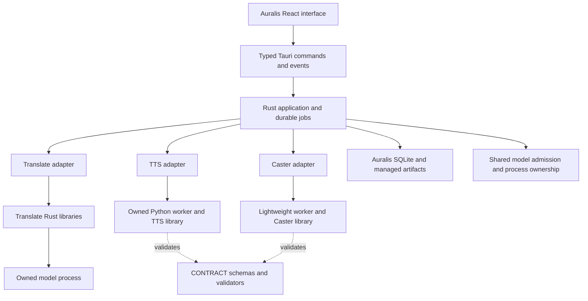

# Auralis module integration architecture

Updated: 10 October 2026. This is the requested integration design and a dated
starting-point record. Current implementation and acceptance boundaries are
summarized in the [integration index](README.md) and its execution records;
the [goal prompts](README.md) remain delivery requirements.

## Delivery scope

Auralis provides one desktop workflow for an immutable subtitle source, a
selected and reviewed Russian translation, voice assignments, real synthesized
speech and verified media export. Translate, TTS and Caster retain reusable
cores and standalone entry points. CONTRACT provides shared data schemas and
validators. Marker integration is deferred.

The owner's 10 October request schedules desktop integration and real TTS work,
replacing the preceding conversational TTS deferral. It does not change
Translate's language or format gates, approve unreviewed translations for speech,
or promote its experimental profiles. Earlier CLI-first scheduling in Translate
documents continues to govern unrelated translation research; this request
authorizes the desktop integration work defined here when its goal is executed.

Caster's existing WPF source, assets, project files, build settings and public
entry points stay unchanged. Caster integration means exposing its reusable
operations inside Auralis. Existing TTS engines and synthesis behavior are the
baseline. Changes to input, lifecycle and packaging are allowed where needed;
algorithm or model changes require a separately declared comparison.

## Observed starting point on 10 October 2026

The following commits were inspected on 10 October. Auralis, Translate and
CONTRACT also contained local changes; these hashes do not identify a clean
tested candidate. Reinspect their diffs and record code hashes at execution.

| Repository | Observed HEAD                            | Relevant existing boundary                                                   |
| ---------- | ---------------------------------------- | ---------------------------------------------------------------------------- |
| Auralis    | d96202532bbe546caa42288347572078afe23e70 | Rust application, ports, jobs, SQLite, managed artifacts and typed Tauri IPC |
| Translate  | b26092fd6949c25e18765eba0349fd7ebebbce21 | Reusable Rust crates, standalone CLI and experimental Auralis adapter        |
| CONTRACT   | 95d3efbbbe15767cf68cbb8995e19d08511ba681 | Python voxscript-contract package, project, voice and casting schemas        |
| TTS        | f23224510d3b04718a1636a816c3d387be0d0a3f | Python render pipeline, VoxCPM2 and ESpeech engines, cache and manifests     |
| Caster     | e5030f53bc20e6e6e0e7d35b9acec6ee253c56b7 | Python voice operations, WPF editor and command wrappers                     |

At this starting point, Auralis compiled Translate libraries through
`adapters-translate` and owned a separate model process. Its `adapters-model`
crate exposed test doubles; the then-current `TtsEnginePort` lacked the complete
production control and lineage contract required by this design. The goal calls
for typed operations instead of fitting production work into the mock shape.

TTS preflight validates the shared project layout, while render consumes the
legacy source.md and cast.json v1 layout. Successful preflight alone therefore
does not prove that the shared project can be synthesized. TTS integration must
close this input gap and retain segment identity through technical splitting.

Caster's caster.ps1 forwards voice operations to CONTRACT and autocasting to
text_marker.cli. Its Python voice editor already reuses CONTRACT. This is not
an independent Caster service yet. The integration must reuse these operations
without introducing Marker as a required installed product or altering WPF.

## Dependencies and responsibilities



Arrows indicate dependencies, not concurrent model execution. One model-serving
or model-loading workload may own the machine admission at a time, including
user-started external servers. Caster preview uses the same TTS admission.

| Owner     | Responsibilities                                                                                                       | Public consumption                            |
| --------- | ---------------------------------------------------------------------------------------------------------------------- | --------------------------------------------- |
| Auralis   | Projects, UI, job queue, process ownership, resource admission, review selection, timing, mixing and final publication | Typed application commands and snapshots      |
| Translate | Inspection, supported subtitle grammar, translation, validation, checkpoints, edits and immutable result versions      | Existing Rust library API                     |
| TTS       | Reference resolution, synthesis, technical text splitting, verified audio cache and synthesis manifests                | Reusable Python API with a headless worker    |
| Caster    | Voice catalog operations, reference metadata and explicit role assignments                                             | Reusable Python facade with a headless worker |
| CONTRACT  | Portable input schemas, validation reports, voice compatibility and data publication rules                             | Versioned package and canonical schema assets |

CONTRACT is a dependency, not a user workflow stage and not a shared database.
It must not acquire Tauri, project scheduling, model loading or inference policy.
Translate has no dependency on TTS or Caster. TTS consumes a voice snapshot,
not a running Caster service. Caster consumes a role snapshot, not a running
Translator or Marker. A lightweight validator may run in a process because its
canonical implementation is Python; that does not make it a model service.

CLI, worker and desktop adapters call the same component core. Domain code is
independent of transport and concrete storage. Rust ports use typed domain data;
filesystem paths, JSON framing and process handles stay in adapters. Add a shared
process component only when concrete adapters reuse the responsibility; avoid a
general plugin framework or empty placeholder crates.

## Repository and package layout

Keep the independent repositories. Translate continues to use its pinned
Auralis submodule and Rust dependencies. Pin Python component wheels, schemas
and runtime requirements in an Auralis delivery manifest. Development may use
editable sibling paths; an installed build must work without those checkouts.

Suggested responsibilities, with names finalized during CONTRACT execution:

```text
auralis/
  crates/ports/                typed speech, voice and execution boundaries
  crates/application/          host orchestration and publication
  crates/adapters-translate/    existing native Translate adapter
  crates/adapters-tts/          worker transport and speech-result verification
  crates/adapters-caster/       catalog and assignment transport
  apps/desktop/                Auralis presentation
  tools/                       reproducible packaging and acceptance commands
CONTRACT/VOXSCRIPT_CONTRACT/     canonical schemas and validators
TTS/PUZA_TTS/src/tts/            reusable synthesis API and worker entry point
CASTER/src/                    reusable voice and casting facade
```

Use a small pinned Python runtime for CONTRACT and Caster, and an isolated pinned
TTS environment for its heavier dependencies. Both consume the same compatible
CONTRACT release. The inspected CONTRACT and Caster packages require Python 3.12;
retain that compatibility boundary until a separate runtime upgrade is verified.
Build an installable package with hashes and explicit model
acquisition; do not depend on the user's global Python, checkout venv or PATH.
Choose embedded Python with wheels or a packaged executable after measuring
startup and verifying the existing native dependencies on clean Windows.
Tauri supports bundled external binaries through its
[sidecar mechanism](https://v2.tauri.app/develop/sidecar/).

Model weights, audio references, caches, mutable databases and generated outputs
are outside application binaries and Git. Runtime installation is explicit,
versioned, recoverable and usable offline after successful acquisition.

## Algorithm and durability

1. Freeze the selected source or reviewed result, text revision, cue identities,
   role assignments, voice references and chosen engine profile. Verify ownership
   and input hashes. Existing sources and ready results remain immutable.
2. Validate a versioned speech plan through CONTRACT. Each utterance maps to its
   source cue or text revision and retains its own identity and optional timing
   window. Do not fake Marker publication status or infer roles silently.
3. Queue a durable host job. Obtain machine admission and verify no competing
   model server before loading the chosen engine. Recheck identity at launch.
4. Inspect audio cache entries and their metadata before using them. Process
   uncached segments in bounded batches. Preserve existing grouping and engine
   reset semantics until an experiment justifies a change.
5. Synthesize sequentially, retain internal chunk to utterance mappings, validate
   audio and persist each accepted checkpoint before reporting saved progress.
   Do not promote incomplete output to a ready project artifact.
6. On cancellation, acknowledge cooperative stop or terminate the owned process
   tree after its declared deadline. Hold admission until exit and resource
   release are established. Recovery validates checkpoints before resuming.
7. Verify complete coverage, source lineage, engine identity, audio hashes and
   measured durations. Auralis performs the declared timing and mixing policy.
   A segment that cannot fit its window produces a visible conflict; it must not
   be clipped, silently accelerated or rewritten to force success.
8. Stage the complete result, then publish through the existing artifact and
   outbox protocol. Recover the gap between component commit and host publication
   idempotently. Retain the earlier ready result until replacement is ready.

Raw speech generation and timeline assembly have separate cache identities.
Changing a cue start time should not regenerate unchanged speech; changing text,
reference content, effective seed, model, engine or synthesis settings must
invalidate affected audio. Cache metadata and bytes are verified before reuse.

Plan segments in a linear pass, index IDs and cache keys, and group only where
the engine contract permits. Group ordering is O(g log g) for g groups; scanning
metadata is O(n), and content hashing is proportional to bytes read. Stream audio
assembly and paginate UI records. Bound in-memory working sets by configured
batch and page sizes. These are design targets, not measured current performance.

## Optimization and acceptance

Measure cold startup, model load, warm synthesis, cache lookup, persistence,
assembly and export separately. Record actual RAM and sampled VRAM, input sizes,
engine/profile hashes, cancellation latency and failures. Avoid speculative
speed claims, parallel inference and changes that weaken checkpoint validation.

Use the unchanged TTS CLI and retained Translate profiles as baselines. An
optimization needs a frozen input, identical effective settings, retained output
and a declared quality review. Existing renderer resets between reference groups
are part of that baseline; warm reuse across groups is an experiment, not a
default change. Prevent avoidable reloading within a proven compatible batch.

Each component has an independent acceptance record. Host assembly additionally
requires real model output, real playable speech, explicit translation and voice
review, timing fit, cancellation and recovery, and a clean Windows install.
Mock and compilation evidence cover contracts only. Missing listening, language
review or installation evidence leaves the corresponding gate open.

The [boundary contract](boundary-contract.md) defines planned data identities and
the [goal prompts](README.md) define finite implementation endpoints. Existing
[job cancellation](../architecture/007-job-runtime.md),
[runtime storage](../architecture/006-runtime-data.md) and
[translation evidence](../translation/README.md) remain governing references.
