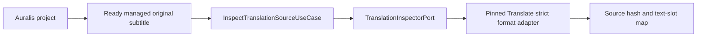

# Auralis Translate integration status

Status: inspection, durable run registration, experimental local-server execution, result publication, and storage integration in progress, 26 September 2026.

The independent Translate repository is pinned as a Git submodule at `modules/auralis-translate`. `.gitmodules` uses the relative sibling URL `../auralis-translate`. This local checkout builds against the pinned commit; the sibling GitHub repository must be created and pushed before another clone can initialise it from GitHub. Auralis excludes the nested workspace from its own workspace members and imports Translate crates through Cargo path dependencies. Translate rusqlite 0.39 and Auralis SQLx 0.9 resolve to one compatible `libsqlite3-sys` version. The opt-in `task desktop:e2e:native:translation` runs a checked local model through the actual Windows React/Tauri desktop and verifies the separate original and output in both databases; the evidence record is `modules/auralis-translate/eval/experiments/2026-09-25-native-tauri-translation.md`.

The pinned Translate CLI has `fetch-release`, `fetch-asset`, and `install-online` for the experimental Windows CPU package. It downloads only assets declared by the checked release manifest, preserves untrusted partial files for HTTP Range retry, and publishes cache entries after pinned length and SHA-256 verification. A real upstream download, online package creation, and installed-model `doctor` passed on the development machine; see `modules/auralis-translate/eval/experiments/2026-09-25-resumable-download.md`. Auralis now exposes installation and selection of that pinned package in the subtitle workspace. A clean offline machine smoke remains open.

The current local pin adds all four package operations, including `install-offline`,
to the CLI machine protocol at
`modules/auralis-translate/docs/reference/cli-protocol-v1.md`.
Versioned requests and verified JSON/JSONL cache/package receipts are available
without launching inference or selecting an Auralis runtime. Typed integrity,
ownership, transport and IO failures preserve earlier verified files without
claiming a completed install. The
evidence record at
`modules/auralis-translate/eval/experiments/2026-09-26-cli-package-protocol.md`
documents ten process regressions, real cache/offline/online receipt verification,
existing-package conflict preservation and a fresh upstream notice download.
Embedded Auralis still calls the Rust adapters directly; clean-machine delivery,
CLI-owned runtime and upgrade/removal remain open. Development stays local.

The opt-in `task desktop:e2e:native:translation:crash` terminates the desktop after one committed model block, verifies Job Object cleanup of the model child, restarts the same executable, and resumes the project-linked run to a ready separate result. Its evidence record is `modules/auralis-translate/eval/experiments/2026-09-25-native-tauri-crash.md`. This synthetic two-cue test does not score translation quality.

The application integration test `crates/application/tests/translation_vtt_publish.rs` now exercises strict WebVTT import, a project-linked host job through both SQLite databases, pending output publication, and selection only after outbox finalization. It checks that the ready WebVTT copy retains protected `NOTE`, timing, CRLF, and header bytes while the managed and external originals remain unchanged. The model response is mocked; interruption/resume and language quality remain open. Evidence is recorded at `modules/auralis-translate/eval/experiments/2026-09-25-auralis-vtt-two-db.md`.

The opt-in `task desktop:e2e:native:translation:vtt` now passes the same strict WebVTT subset through the actual React/Tauri desktop and a managed checked local model. The native harness verifies the project link, host job, matching Translate result and publication revisions, ready separate artifact, unchanged original, and byte-preserved header, `NOTE`, timing and CRLF. Its evidence record is `modules/auralis-translate/eval/experiments/2026-09-25-native-vtt-translation.md`. This is a one-cue completion check; the separate crash test below covers one two-cue interruption boundary.

The opt-in `task desktop:e2e:native:translation:vtt:crash` passes a two-cue checked-model WebVTT run after terminating the desktop and managed model child at the first committed checkpoint. On restart, the same run retains that checkpoint, makes a second attempt for the missing block, and publishes a separate ready WebVTT artifact. Evidence is recorded at `modules/auralis-translate/eval/experiments/2026-09-25-native-vtt-crash-resume.md`. Wider WebVTT coverage and bilingual quality remain open.

The pinned Translate submodule also provides `task eval:cli:vtt:interruption`, an opt-in standalone CLI checked-model test. It terminates the CLI after the first of three WebVTT blocks, verifies that no partial output exists, then resumes into a separate file while retaining the first checkpoint. See `modules/auralis-translate/eval/experiments/2026-09-25-cli-vtt-interruption.md`. This does not exercise Auralis publication.

The desktop bootstrap reserves one installation-wide `auralis-translate.sqlite` beside `auralis.sqlite`, constructs the strict Translate application use cases, and replays active frozen run intents after acquiring the application data-root lease. Individual registration failures are logged against their translation ID while desktop startup continues. After reconciliation, it enumerates only Auralis-linked active translation jobs, asks Translate SQLite to pause a running attempt only when its `host_job_id` matches, and atomically terminalizes each recovered host job. A mismatched or unavailable Translate run leaves the association active and is logged for attention. This startup pass does not resume inference. The read-only Tauri command `inspect_translation_source_cmd` accepts a project ID, managed original artifact ID, and `srt` or `vtt`; it returns the source digest, parser version, timing, cue identity, source text lines, and exact byte ranges. `list_project_translations_cmd` returns only an existing project's links, including unfinished `run_id` and ready selected `result_id`/artifact identities. Project-scoped `get_translation_run_status_cmd` and `pause_translation_run_cmd` expose committed progress and durable pause requests. `begin_translation_run_cmd` accepts stable caller-generated IDs for retry, currently permits Chinese input, and freezes the versioned checked experimental Hy-MT2 profile; a repeated call retains the original frozen timestamp. `edit_translation_result_cmd` stores a new result ID, and `publish_translation_result_cmd` returns a pending or ready publication while the outbox finalizes a separate copy. With a configured local runtime, `start_translation_run_cmd` admits a checked model, creates a linked host job, attaches a gated worker to the shared Auralis job runtime registry, and returns accepted job/run IDs. The background worker executes the attempt and stages a validated publication. The subtitle workspace exposes start, resume, committed progress and durable pause controls.

The desktop frontend declares these commands in its typed IPC map and validates their responses at runtime, including bounded byte ranges inside the reported source size, paired selected result/artifact identities, publication state, and the result identity of a validated run. `get_translation_comparison_cmd` reads a requested result as pages of 1–100 paired source and translated segments. It checks the project-owned original, frozen parser version, Translate source/run/result identities, and reconstructed output digest. A ready older publication remains readable after a newer run starts; a page past the end is empty. The page limit bounds the IPC response; the backend still verifies the full result before slicing it. The project subtitle workspace lists project-linked translations and compares the currently selected ready result in pages of 25 segments. It shows the source and translated lines and the `needs_review` label and can stage a one-segment edited revision. The run panel refreshes the comparison when polling observes a changed ready selection. Historical revision selection remains open.

The host translation job design in `modules/auralis-translate/docs/architecture/006-host-translation-jobs.md` defines the remaining S7 work: a translation job linked to a run and attempt, managed model runtime, and recovery scoped to Auralis-owned attempts. A distinct `Translation` job kind round-trips through the Auralis jobs table without changing the project's dubbing processing state. SQLite schema v8 adds `translation_host_jobs`: each job can reference one frozen run intent, historical jobs remain available, and a partial unique index permits at most one association with no `ended_at` per run. The migration preserves version-7 project links and run intents. `SqliteTranslationHostJobStore` atomically creates a pending job with its active run association, verifies the project and frozen intent, records checkpoint progress with revision checks, and atomically closes the association with a terminal job revision. `StartTranslationJobUseCase` checks project ownership, the frozen run and Translate phase, then creates or returns the pending job. The application recovery use case preserves committed Translate checkpoints, repairs a lagging host counter before closing a running job, closes pending jobs after restart, and leaves mismatched attempts untouched. The existing dubbing recovery excludes translation jobs. The caller-driven `RunTranslationHostJobUseCase` moves a pending job to running, passes its ID into Translate's durable attempt, mirrors only committed block counts into the running job, and atomically closes the host association as completed, failed, or cancelled. The count includes previously saved checkpoints on resume; the host percentage remains below 100 until completion. Mirror failures are logged while Translate SQLite retains the authoritative checkpoints. A mock HTTP test covers host-owned execution, saved progress, and separate artifact publication across the two databases; an unreachable-server test leaves zero saved blocks, a resumable failed run, and an unchanged original. A mock-based worker-subprocess kill test commits one Translate checkpoint, repairs lagging host progress, retains the project run link, and permits a new pending attempt. A separate opt-in checked-model worker-kill test documented in `modules/auralis-translate/eval/experiments/2026-09-25-managed-worker-crash.md` verifies that the managed model child exits after worker termination and that the same run completes its missing block through both SQLite files and ready output publication. The native Tauri checked-model test covers the command path without interruption. A two-cue native desktop crash/restart test now retains the first checkpoint and publishes the resumed result. Clean-machine installation verification and event-driven UI progress remain open.

The embedded HTTP adapter enables reqwest's rustls provider explicitly. A full workspace test exposed a feature-unification panic when reqwest had no provider; the aligned Auralis lockfile uses rustls 0.23.43 from the available offline dependency set. The full `task rs:test` passes with Translate pinned to the provider fix.

The background scheduler evidence at `modules/auralis-translate/eval/experiments/2026-09-25-background-job-scheduler.md` records the accepted IPC response, attached shared worker, native checked-model completion, and checkpoint-preserving desktop restart. The command's admission still verifies and starts the local model before responding; the inference and publication continue in the attached worker. Event-driven progress, clean-machine installation verification, and the language-quality gates remain open.

Repeated start requests reuse a running host job without acquiring another model lease. If two schedulers race while the job is pending, the runtime reservation admits one worker; a competing reservation returns that same still-active job and never compensates or closes it. A non-conflict reservation failure still closes the pending job for recovery. Application tests cover concurrent SQLite job creation and the duplicate-reservation boundary. The native `task desktop:e2e:native:single-owner` test launches two real desktop processes on one data root and confirms that the second exits at the storage lease while the first remains healthy; see `modules/auralis-translate/eval/experiments/2026-09-25-native-single-owner.md`. Same-process translation IPC races remain open.

## Managed runtime setup for the current development build

The subtitle workspace can download the pinned experimental Windows x64 CPU release into the Auralis application-data cache, verify every asset, and install it under `translation-packages/<release-id>/cpu/`. The user then explicitly selects the installed package. Auralis writes `translation-package-selection.json` with only the catalog ID and backend, builds the managed runtime from its owned package paths, and applies the choice to new jobs without restarting the desktop. A selected package is rechecked before model admission. Selection waits for an in-progress start request and refuses to change while any translation host job is active. Pinned-package repair is implemented below; upgrades, rollback between distinct releases, and safe removal still need product behavior. The package boundary in `modules/auralis-translate/docs/architecture/007-model-installation.md` and the local installation record in `modules/auralis-translate/eval/experiments/2026-09-26-auralis-package-selection.md` describe the evidence. Clean offline machine verification remains open.

The opt-in `task desktop:e2e:native:translation:package ASSET_DIR=ABSOLUTE_CACHE_DIR` mounts the package controls in the native Tauri WebView, installs and selects the pinned CPU package, restarts the desktop, and translates one synthetic SRT cue through the installed runtime. It leaves the manual runtime file absent. The evidence at `modules/auralis-translate/eval/experiments/2026-09-26-native-package-translation.md` records the observed pass and limits.

The older `translation-runtime.json` beside `auralis.sqlite` remains a development fallback when no package is selected. The file is optional so the rest of Auralis starts without installed model assets. Both paths must be absolute and point to an installed `llama-server` executable and the GGUF named by the frozen checked profile. Example for a local Windows development installation:

```json
{
  "executable": "C:/path/to/llama-server.exe",
  "model_file": "C:/path/to/Hy-MT2-1.8B-Q4_K_M.gguf",
  "context_tokens": 2048,
  "gpu_layers": 99,
  "ram_cache_mib": 0,
  "startup_timeout_seconds": 120,
  "readiness_interval_milliseconds": 250
}
```

`gpu_layers: 0` selects a CPU-only attempt. The runtime validates configuration values at startup and checks installed files when a run starts. The start command checks project/run ownership and Translate phase, reserves the single model slot, verifies the frozen profile and installed model digest, launches its own loopback child, checks the server's reported model/runtime identity, then creates the host job. An admission error leaves no new job. Windows process ownership uses a kill-on-drop Job Object; Unix currently kills the direct child on drop. The lease ends before output staging. Translate SQLite retains checkpoints and the Auralis project link through failure or pause; the outbox selects a result only after its separate output artifact becomes ready.

`ram_cache_mib` bounds llama.cpp's transient cross-request RAM cache to 0–512 MiB; omitted values default to 0. Both development and installed-package runtimes pass that value explicitly and use one generation slot. This preserves older configuration files and does not alter durable Translate checkpoints. The cache budget does not bound total RAM or VRAM. The policy and the observed growth that prompted it are recorded in `modules/auralis-translate/docs/architecture/008-managed-runtime-memory.md`; the local long-file task measures the explicit setting separately from its upstream-default baseline.

The UI polls committed progress every three seconds and distinguishes `pause_requested` from `paused`. A pause interrupts the active request or cooperative preparation and is acknowledged only after cleanup; retained checkpoints remain valid. The manual configuration file remains a development contract; the selected package marker takes precedence. Opt-in managed-process tests have passed through both real SQLite files, including a worker kill after one committed block, child-process cleanup, same-run resume, and output finalization using the checked local model. Native Tauri invocation and one committed-checkpoint desktop crash/restart have passed. Native installation, selection, restart, and one-cue CPU translation now pass; clean-machine packaging, bilingual review, and progress events remain open.

## Implemented boundary

`ImportTranslationSourceUseCase` now imports a local SRT or WebVTT file into an existing project without altering the external file. It requires an extension matching the requested strict format, parses the source before staging, verifies that the staged managed copy has the inspected size and SHA-256, and atomically records a pending `OriginalSubtitle` artifact with an outbox finalization action. The desktop subtitle workspace offers a file picker, lists pending and ready originals, and lets the user prepare a Chinese → Russian frozen run from a ready original with stable retry IDs. Import does not start inference. A two-database integration test finalizes an imported copy, inspects it, registers a Translate run, rejects unsupported input, and confirms the external original is unchanged.

`adapters-translate::FormatInspector` calls the strict Translate SRT and WebVTT parsers through `TranslationInspectorPort`. It reads no more than each parser's declared maximum, returns the source SHA-256, exact segment text ranges, timing, order, and optional external cue label, and rejects unsupported syntax. It does not modify the input. The adapter and Translate SQLite compile in the same Auralis Cargo graph.

`InspectTranslationSourceUseCase` checks that the project exists, that the source artifact is a ready managed `OriginalSubtitle` owned by that project, and that its recorded size matches the inspected file. It resolves the path through the Auralis artifact store before calling the inspector. Tests cover valid SRT/WebVTT extraction at the adapter boundary, rejected WebVTT syntax, project ownership, pending artifacts, changed source size, and unchanged source bytes on successful inspection.



Inspection is exposed through a read-only Tauri command and typed frontend IPC, but no UI screen calls it yet. Auralis SQLite schema v7 provides `begin_with_run_intent`, which atomically stores the project link and the exact frozen profile and planning configuration needed to retry Translate run creation. Schema v8 adds the host job/run association without changing this intent. `BeginTranslationUseCase` validates a ready project-owned original, inspects its strict format, freezes a validated model profile and parser policy, commits the link and run intent, then calls `TranslateRunRegistrar::ensure_run` against the separate SQLite file. Registration verifies the original hash and frozen configuration again before writing Translate translations, source segments, and the block plan. Repeating the same request is idempotent; a changed source or profile conflicts.

`ReconcileTranslationRunsUseCase` enumerates active links, reads their frozen intents, rechecks the original, and retries missing Translate records. It reports each link's outcome independently, including a legacy link with no frozen intent. A real two-database integration test starts with the Translate database directory absent, observes the persisted Auralis link, then creates the directory and reconciles the run. The original remains byte-for-byte unchanged. A project result is selected only after the translated copy is a ready managed artifact.

`ExecuteTranslationUseCase` rechecks the project-owned original and frozen run intent, ensures Translate records exist, then calls `TranslateRunExecutor`. The executor verifies the stored run and model profile, probes the supplied local llama.cpp server with the shared Translate preflight, executes missing blocks, and commits a structurally validated `needs_review` result in Translate SQLite. Repeating execution of a validated run returns its stored result ID. A checked model profile is required by the normal constructor; `experimental_unchecked` is restricted to development tests. A mock HTTP server test exercises execution and publication through the two databases while preserving the original bytes. This path is an application API with a caller-supplied server URL. The managed start command now owns a checked runtime lease and is exposed in the desktop UI; a one-cue native checked-model E2E passed. Clean-machine package validation, progress events and prompt cancellation during admission remain open. The mock HTTP and native tests establish protocol and persistence behavior, not real-model translation quality.

`TranslationRunUseCase` reads the active run's phase, committed block count, pending pause flag, and validated result identity through `TranslateRunControl`. It accepts a pause request only for a project-owned link whose Translate records match the linked source. An in-flight worker polls the durable flag during HTTP response headers/body reads and rechecks it at acceptance boundaries; unfinished output is discarded. Calling execution again after an acknowledged pause resumes the same run and skips saved checkpoints. Tests cover pre-run pause/resume, a pause flag on a running attempt, project mismatch rejection, and the final result status. The run panel now polls this control API; the background host worker requests a durable pause when its runtime cancellation signal fires.

`PublishTranslationResultUseCase` accepts a specific stored `result_id`. The Translate adapter confirms its run and source identities, renders a separate SRT/WebVTT copy from the original and selected segments, and checks the stored output digest. Auralis stages that copy, hashes the staged bytes, and atomically records the pending artifact, publication, and outbox action. Repeating the call returns the same pending or ready publication. The outbox worker selects the result only after finalizing the artifact. A real two-database test uses a deterministic mock HTTP model response to verify host job execution, publication, and an unchanged original; it does not establish language quality.

`EditTranslationResultUseCase` checks project ownership, the original source, and the run recorded by either the active link or its ready selected publication. The Translate editor verifies the frozen run and base result, then commits a manual segment edit as a new immutable `needs_review` result. It rejects a stale base revision, invalid text, and changed source or run identity. The publication use case can stage a revision from the same selected run after the active run has closed. Its pending artifact and outbox retain the earlier ready selection until the new copy is ready; the storage comparison checks the link revision, selected run, source hash, and ready artifact before switching result IDs. A mock HTTP two-database test covers edits both before and after first publication, idempotent edit replay, stale-base rejection, unchanged original and earlier output bytes, and rejection of a staged selection after a newer run starts. Tauri and typed frontend IPC expose edit, publication, and paginated comparison. The subtitle workspace can edit one selected result segment and stage the new copy; a failed publication retries with the same edit ID. The run panel polls project links and refreshes comparison when a changed ready result is selected. Older revision selection and event-driven progress remain open.

## Project deletion

Project deletion commits a `delete_project_translation` outbox intent for every linked translation in the same Auralis transaction that removes the project. The outbox adapter invokes Translate SQLite cleanup, which deletes translation-owned state and records a tombstone against late registration. Failed cleanup remains retryable even after five attempts, with a capped delay. The local two-database test covers temporary Translate unavailability and eventual cleanup. A native Tauri running-attempt test, recorded in the pinned submodule at `modules/auralis-translate/eval/experiments/2026-09-25-native-project-deletion.md`, verifies model-process termination, outbox cleanup, removal of project-owned records and managed files, and preservation of the external original. Other deletion interleavings remain open.

## Startup publication recovery

After frozen-run reconciliation and scoped host-job recovery, `RecoverTranslationPublicationsUseCase` scans links with an active run or a ready selected result. It resolves the run from the active link or its selected publication, then asks Translate SQLite for that run's latest immutable result. Only if this exact `result_id` has no Auralis publication does it reconstruct the separate output from the original and stage it. An earlier model-result publication does not hide a later committed edit. Existing pending or ready publication of the latest result is left with the outbox; a failed one is reported for attention. Each link failure is logged independently and does not stop desktop startup. The test at `modules/auralis-translate/eval/experiments/2026-09-25-result-gap-recovery.md` covers a crash after model result commit, idempotent staging, another reopening before outbox finalization, ready selection, and unchanged original bytes. A separate two-database test covers recovery of edits both before and after the first selection. The opt-in `task desktop:e2e:native:translation:result-gap` now kills the native desktop after Translate validates the exact result and before Auralis writes its publication, then verifies restart recovery into a ready separate artifact; see `modules/auralis-translate/eval/experiments/2026-09-25-native-result-gap.md`. The test-only hook is compiled only for `native-e2e`.

Auralis SQLite schema v9 records Translate's immutable result revision on each publication. If an original model result and a later edit are both staged against the same run and link revision, the outbox waits for the latest revision's artifact and selects only that revision. Direct selection of an older publication conflicts. A failed newer publication requires attention rather than silently selecting the older result. Existing v8 rows migrate with revision 1; equal-revision historical rows use insertion order. A storage regression covers both ready publications, reverse selection, and failed-newer behavior. This closes the known local publication-order race; concurrent desktop process and cross-database failure injection remain separate checks.

## Checks

### Pinned package repair and delivery checks

The subtitle workspace has a **Check and repair** action for an installed package. The host rejects installation/repair and selection while translation jobs are active and serializes both with run admission. Repair assembles and verifies a private candidate before moving the previous directory aside; it restores or cleans `.previous-cpu` on retry and retains the selection marker. An already selected runtime is refreshed after repair.

Package selection and repair verify the pinned GGUF, notices, and retained archives. Every extracted executable/DLL/runtime notice is checked against the retained digest-verified archive, including same-length changes and undeclared files. `InstalledPackageRuntime` repeats this runtime-file check in a blocking worker before `ManagedLlamaRuntime` performs model verification and starts the process. Startup reconstructs the wrapper without reading the entire model on the UI thread. The manual development runtime configuration remains separate from the installed-package path.

`task rs:test:translate:package ASSET_DIR=ABSOLUTE_PINNED_CACHE` is an opt-in real package lifecycle test. It installs, selects, corrupts the temporary extracted executable and GGUF, rejects acquisition/selection, simulates a missing-final-directory interruption, repairs, and restores selection after reopening. The test operates in a temporary package directory and does not change the source asset cache. Default package behavior tests are under `crates/adapters-translate/tests/`, outside product code.

`task q:translation-delivery` tests the exclusion policy and release publication allowlist. `task fe:build` inspects emitted frontend modules/files and bounded Tauri resources; `task media:bundle:verify` rejects model weights and test/evaluation payloads in the materialized native bundle. Model weights come from pinned upstream URLs only after an explicit application download action and are never Auralis release assets. Development corpora, generated files, and reports are not bundled.

The pinned submodule contains the real ten-row comparison runner (`task eval:cli:flores:file`) and evidence at `modules/auralis-translate/eval/experiments/2026-09-26-flores-file-comparison.md`. Full source/reference/candidate reports remain in the standalone Translate checkout's ignored `.cache/eval/file-runs/` directory. Artificial timing is used solely for file transport, so the result does not establish subtitle adequacy or language release readiness. Package repair evidence is at `modules/auralis-translate/eval/experiments/2026-09-26-package-repair.md`; clean-machine, upgrade/removal, and orphan cleanup remain open.

The final real cached-package corruption/repair test passed in 825.41 seconds, and native package installation, restart, and real CPU translation passed with the pre-acquisition integrity wrapper. `task fe:build` passed the emitted-payload audit; `task rs:build:release` produced an optimized 17,555,968-byte application executable without the native test feature. Delivery evidence is at `modules/auralis-translate/eval/experiments/2026-09-26-translation-delivery-audit.md`. A signed installer and clean-machine gate remain unverified. On 26 September the owner deferred public publication; the submodule remains a local development integration.

The pinned submodule now adds `task eval:cli:flores:profiles`, run from the standalone Translate checkout with explicitly supplied assets, and `task eval:profiles:verify REPORT_DIR=ABSOLUTE_REPORT_DIRECTORY`. Three real variants completed the same ten development sentences with separate state and outputs, unchanged originals, and identical offline re-export. Seven harness checks and retained corpus/profile/artifact verification passed. Evidence is at `modules/auralis-translate/eval/experiments/2026-09-26-profile-comparison.md`, with the protocol at `modules/auralis-translate/docs/evaluation/004-model-profile-comparison.md`. Zero-temperature decoding retained observed grammar errors; the JSON variant introduced a terminology substitution. No quality winner was selected, the desktop profile is unchanged, and complete reports stay in ignored local storage.

The standalone `task eval:cli:long:interruption` now passes 1024-cue/1280-slot SRT and WebVTT recovery probes with the real checked model. Four format runs preserve the 16 saved checkpoints, finish 128/128 blocks, keep originals/protected bytes unchanged and re-export identical results offline. Explicit zero RAM cache reduced sampled model working set from about 5.7 GB to 1.54 GB on the observed machine. This prompted the managed default above; it is not a total-memory cap or quality verdict. Evidence is at `modules/auralis-translate/eval/experiments/2026-09-26-long-file-recovery.md`.

After this runtime change, `task rs:clippy` and `task rs:test:translate` passed. The opt-in `task rs:test:translate -- --test managed_runtime_real -- --ignored --nocapture` passed in 158.03 seconds with supplied assets, verifying one actual server slot and child release. The default admission tests accept the documented cache range and reject oversized values before process startup. Clean-machine and resource coexistence gates remain open.

`task desktop:e2e:native:translation` also passed after this change with the harness's existing configuration, which omits `ram_cache_mib`. The actual desktop defaulting path remains compatible and publishes a separate verified result through both databases; the isolated test sandbox was removed. Its first sandboxed invocation could not execute bundled ffmpeg, so the task was repeated with local tool execution permitted. This one-cue run does not close the language or clean-machine gates.

A fresh local `task desktop:bundle -- --bundles msi` and `task desktop:bundle:from-build -- --bundles msi` now pass actual installer-content verification. The extracted tree has the application, seven media/compliance files and the MSI administrative copy, with no model/test payloads. `desktop:before-bundle` captures source identity and the active marker offset; the signing wrapper binds that source to the complete package executable, preserving Tauri's package marker/signing behavior. Initial direct-hash and marker-search attempts failed; the corrected verifier rejects missing/stale records and corrupt/duplicate application files. Evidence is at `modules/auralis-translate/eval/experiments/2026-09-26-windows-msi-content.md`; the unexecuted clean Windows protocol is at `modules/auralis-translate/docs/evaluation/006-clean-windows-installation.md`. Local packages remain unsigned, and G9 is open.

From the Auralis repository root, run `task rs:test:translate`, `task rs:test:ports`, `task rs:test:storage`, `task rs:test:application`, and `task rs:clippy`. The Translate submodule has its own `task check` and `task build`. Compilation and mock-based tests do not establish bilingual translation quality or a supported release configuration.

The local Translate pin now implements `RunControl` during HTTP headers/body
reads. It polls a durable pause request, drops unfinished inference output, and
keeps saved checkpoints for the next attempt. Idle pooling is disabled across
synchronous model hashing/checkpoint work. The Auralis adapter maps acknowledgment
to `PortError::Cancelled`, records `pause requested`, closes the Translate attempt
as paused, and lets the host job and managed lease finish through their existing
ownership path. `task rs:test:translate` verifies cancellation of an unanswered
mock request with no result; checked-model SRT/WebVTT CLI evidence is at
`modules/auralis-translate/eval/experiments/2026-09-26-request-cancellation.md`.
Native pause and same-process race verdicts must be recorded separately.

`task desktop:e2e:native:translation:pause` now passed with the checked installed
assets. React/Tauri pauses after one saved block, while the outer harness checks
the cancelled host job, paused Translate attempt, unchanged active run, absent
result/publication and managed child release. A test-only title barrier then
releases resume in the same desktop. Final verification requires two closed
attempts with different host IDs, a cancelled first job, completed second job,
an identical full first-checkpoint row and separate ready output. The first run
failed on a missing feature-gated test checkpoint label; the corrected full run
passed and cleaned its sandbox. Evidence is at
`modules/auralis-translate/eval/experiments/2026-09-26-native-pause-resume.md`.
Native WebVTT pause, pre-attempt admission cancellation and simultaneous command
interleavings remain open. The updated lockfile uses Tokio 1.53.1; Rust adapter,
port, application and Clippy checks passed. The production frontend build also
passed the exclusion audit for the new native scenario.

The managed worker now reports durable UI pause as `RuntimeTaskOutcome::Cancelled`
even when its runtime cancellation token is unset. The two-database scheduler
regression observes the actual attached task completion, a cancelled host job and
paused Translate state after interrupting an unanswered mock HTTP request.
`task rs:test:application -- --test translation_scheduler_pause --test translation_host_execution_failure`,
`task rs:fmt` and `task rs:clippy` passed. The earlier MSI above predates these
cancellation changes. A fresh `task desktop:bundle -- --bundles msi` now passed
with source revision `0695d55029366a152136f1faf9160c03456649e8` and Translate
`2897b1c7a6d3bccef64a9b242a244ef17c1c5bbb`. It verifies nine extracted files,
the complete packaged application identity and exclusion of weights/test data.
The new unsigned MSI has SHA-256
`c702e1b9ee3b06ebe891f8c7221bbc22265c8ee070b234fb455aa610bb5ee007` and a retained
copy under `.cache/installer-audits/cancellation-2026-09-26-1200/`. Evidence and
the separate authored QA handoff are recorded at
`modules/auralis-translate/eval/experiments/2026-09-26-windows-msi-cancellation.md`.
The handoff is not an application resource; its clean-environment report remains
unexecuted. Signed delivery and the unseeded setup/offline gate remain open.

The local Translate pin now includes opt-in standalone CLI JSON/JSONL, bounded
named requests, durable progress and stable machine exit codes. Seven real-process
and SQLite tests cover both formats, pause/resume, output failure after result
commit and immutable edit recovery. `task check`, `task test:cli:protocol` and
`task eval:cli:protocol` passed in the standalone checkout; the last task uses
supplied checked local assets for four authored cues per format, followed by
identical offline re-export. The protocol and evidence are at
`modules/auralis-translate/docs/reference/cli-protocol-v1.md`
and `modules/auralis-translate/eval/experiments/2026-09-26-cli-machine-protocol.md`.
Auralis still calls the library directly. This slice changes only CLI code and
documentation, so the prior MSI's application runtime is unaffected; its exact
source identity remains recorded above. Machine installation commands, CLI-owned
runtime, richer provider errors and language release gates remain open. No public
publication was performed.

`task desktop:e2e:native:translation:vtt:pause` now passed through the actual
React/Tauri desktop and installed checked model. The shared verifier requires a
cancelled first host job, closed Translate attempt, retained active run and first
checkpoint, no result/publication or translated artifact at pause, and release of
the managed child. Same-process resume creates a distinct host job, preserves every
first-checkpoint field and publishes a separate ready review-required output.
Both original copies retain the initial source digest; protected WebVTT header,
NOTE, timing and CRLF survive. The runner emits a compact identity record and
removes the test sandbox/frontend build. Evidence is at
`modules/auralis-translate/eval/experiments/2026-09-26-native-vtt-pause-resume.md`.
`task q:translation-delivery` passed eight policy/publication tests; documentation
checks passed in both repositories. The prior native WebVTT pause gap is now closed
for this named synthetic scenario. Concurrent commands, prompt pre-attempt cancellation,
clean Windows installation and language quality remain open. No product Rust or
production frontend code changed in this test tooling slice.

## Guarded attempt admission

Translate schema v5 adds a durable run control revision. A managed start captures
the run ID, phase and revision before runtime acquisition, retains it through the
host job and passes it to the executor. Each pause, including a repeated pause on
an already-paused resume, invalidates the older guard. Auralis rechecks it after
acquisition even on runtime failure and requires the original active run when
creating the pending job. Translate rechecks it in an immediate transaction before
clearing pause and creating the attempt. Explicit resume captures the latest
revision; the guard is transient and is not duplicated into the host database or
frontend status schema.

`task rs:test:application -- --test translation_admission_pause` passed five
two-database tests. Newer pause prevents host job creation, drops the acquired
lease and takes precedence over a simultaneous runtime failure. Without a new
pause, acquisition retains its error. Pause after admission but before the worker
starts closes the host job as cancelled, creates no model HTTP request or Translate
attempt/result, retains the project run and leaves the source unchanged. A fresh
explicit resume still admits that paused run. The controlled runtime is test
infrastructure, not model support evidence. `task rs:test:translate` passed the
default adapter suite; its two installed-model/package cases are opt-in.
`task rs:clippy`, the full default `task rs:test:application` suite and
`task rs:test:ports` (19 cases) also passed. Real-model application cases remain
opt-in. No frontend status schema changed.

The independent CLI passed `task eval:cli:protocol` with the installed checked
model after this guard change: separate SRT/WebVTT outputs and identical offline
export. Evidence and retained identities are recorded at
`modules/auralis-translate/eval/experiments/2026-09-26-attempt-admission-guard.md`.
The guard is now combined with cooperative preparation control described below.
Initial-hash native evidence is recorded below. Admission command races, fresh
package audit, clean Windows installation and bilingual quality remain open.

## Cooperative preparation cancellation

`TranslationModelRuntimePort::acquire_with_control` carries an owned cancellation
token through installed-package verification, initial model hashing, child startup
and readiness/preflight. The ordinary `acquire` facade supplies a fresh token.
Managed admission polls its linked durable start guard with a validated 10–1000 ms
policy, default 250 ms. On a control change/error it signals cancellation and awaits
cleanup. The model adapter checks a synchronous callback at hash/decompression
chunk and HTTP headers/body boundaries. Runtime workers are joined rather than
abandoned by a timeout; readiness also checks the existing startup deadline.
Acquisition failure kills/reaps the owned child before the slot is released.
`CleanupFailed` propagates even after pause and maps to the existing native
`RECOVERY_REQUIRED` code. Successful admission disarms its cancellation drop guard.

The host executor's final checked-server preflight uses throttled SQLite guard
checks and rechecks the guard without throttling before considering the outcome.
It still requires the guard atomically at attempt creation. Original, checkpoint,
result and status wire schemas remain unchanged.

The React panel now exposes **Pause** during a pending start/resume request,
labels model preparation and refreshes cancelled admission without a failure
alert. `task fe:test:components -- src/features/translation-run-control/ui/TranslationRunControl.test.tsx`
passed six cases; `task fe:typecheck` and `task fe:lint` passed.
`task rs:test:translate` and `task rs:clippy` passed.
`task rs:test:translate -- --test managed_runtime_real -- --ignored --nocapture`
passed successful real checked admission, one slot and owned-child release in
166.66 seconds. Controlled application tests cancel initial/resumed admission
without releasing the runtime barrier and retain the paused project run.
The full default `task rs:test:application` suite passed, including eight admission
cases and cleanup failure taking precedence over cancellation acknowledgment.

Evidence and command scope are at
`modules/auralis-translate/eval/experiments/2026-09-26-preparation-cancellation.md`.
A native post-child preparation pause is now recorded at
`modules/auralis-translate/eval/experiments/2026-09-26-native-preparation-pause.md`.
`task desktop:e2e:native:translation:preparation-pause` passed on its full repeat:
the actual panel's Start/Pause/Continue buttons retain the same run, acknowledge
pause in one observed 310 ms interval, leave all job/attempt/checkpoint/result/
publication/output counts zero and release the observed desktop-owned model child.
Fresh resume creates exactly one completed job and one closed Translate attempt,
then publishes a separate ready `needs_review` artifact with an unchanged original.
The first invocation failed because the helper confused scheduler acceptance with
attempt creation; the corrected helper waits through the worker's checked preflight.
The test does not slow down, block or replace model preparation.

`task desktop:e2e:native:preparation:check` passed four rejection checks.
`task q:fsd-boundaries`, `task q:ipc-contract`, `task q:file-size`,
`task q:duplicate-code` and `task fe:build` passed. The production build excludes
the native test modules, weights and evaluation data; its 16 emitted frontend
files passed delivery checks. The later initial-hash and accepted-worker scenarios
below extend preparation evidence. Full command interleavings, packaging and
language gates remain open. The accepted-worker status correction below addresses the retained paused
display interval; event-driven UI progress remains work. This is one development
machine observation, not a latency SLA. Development and the submodule stay local.

## Accepted host work and preparation status

`GetTranslationRunStatusUseCase` reads the existing project-scoped Translate
snapshot and the exact run's active host association. It validates host ownership
and exposes a required nullable `activeHostJobId` in the desktop DTO. Errors are
propagated; core Translate phases, SQLite and the CLI protocol are unchanged.
The panel keeps preparation visible after acceptance, retains Pause, disables
another Start/Continue, and restores that view after remount. The accepted job/run
identity bridges a delayed first status refresh. Updates still use polling.

`task rs:test:application -- --test translation_run_status` passed two real
two-database tests; the full `task rs:test:application` default suite passed.
`task fe:test:components -- src/features/translation-run-control/ui/TranslationRunControl.test.tsx`
passed nine cases, and `task fe:test:unit -- src/shared/api/contracts/runtimeValidation.test.ts`
passed fifteen cases. `task rs:clippy`, `task fe:typecheck`, `task fe:lint`,
`task q:ipc-contract`, `task q:fsd-boundaries`, `task q:file-size`,
`task q:duplicate-code` and `task fe:build` passed. Production delivery checks
again exclude weights, evaluation data and native test modules.

The enhanced `task desktop:e2e:native:translation:preparation-pause` passed twice.
The final repeat rebuilt after the accepted-ID handoff correction and observed
209 ms preparation acknowledgement, zero partial/admitted records, child absence
at verification, restored worker-preflight controls, one completed resumed job
and one closed attempt, and the unchanged original/separate ready output.
Evidence and exact identities are recorded at
`modules/auralis-translate/eval/experiments/2026-09-26-host-execution-status.md`;
the contract is in `docs/architecture/012-host-execution-status.md` there.

The later initial-hash and worker-preflight records cover those named pause
boundaries. Additional repeated/concurrent commands, clean installation and
language quality remain open. The subsequent admission-completion correction
below addresses masking of `CleanupFailed` after a newer control change through
a deterministic public-use-case regression. Actual Windows cleanup failure still
needs its own evidence. Work and commits remain local.

## Admission-completion cleanup precedence

The correction to `admit_runtime.rs` retains the outcome of its final guard check
until it classifies the acquisition result. `CleanupFailed` survives a new pause
or final control-read error; an ordinary error or successful lease still requires
that guard. The polling-cancellation branch and atomic attempt admission retain
their previous behavior. This applies the existing preparation contract without
changing database, core, IPC or CLI schemas.

`task rs:test:application -- --test translation_admission_completion` reproduced
the masking defect before the correction. After correction,
`task rs:test:application -- --test translation_admission_completion --test translation_admission_pause --test translation_run_status`
passed 12 tests. The new pair deterministically covers four completion/guard
outcomes through two real SQLite files, with no jobs, attempts, checkpoints,
results or publications and an unchanged original. `task rs:test:application`
passed all 103 unit tests and default integrations; three real-model cases remain
opt-in. Runtime/control decorators are confined to `tests/support/`; no production
API exists solely for testing.

`task rs:test:desktop -- --test translation_cleanup_error` passed a separate
integration test for the actual mapper/wire contract: cleanup failure remains
`RECOVERY_REQUIRED` with restart guidance and no private paths/raw diagnostics;
ordinary cancellation remains `CANCELLED`. The restricted Tauri build initially
reported OS error 5 while preparing an existing media resource; the same command
passed with local build-script permission. `task rs:clippy`, `task rs:fmt-write`
and `task q:file-size` passed. `task q:duplicate-code` passed its production
frontend policy; it does not validate Rust test duplication.

Evidence is at
`modules/auralis-translate/eval/experiments/2026-09-26-admission-completion-cleanup.md`.
This closes the code-review finding above for the tested completion branch.
Actual Windows kill/reap failure, command interleavings, clean installation and
language quality remain open. This slice supplies no new native inference evidence.

## Native accepted-worker preflight pause

`task desktop:e2e:native:translation:worker-preflight-pause` extends the existing
admission-pause scenario with an actual Pause click after scheduler acceptance
and panel remount. Before that click the outer observer requires one running
translation host job/open association, no Translate attempt or partial output,
and exactly one desktop-owned model child. After acknowledgment the same host job
must be cancelled and closed, its guard revision invalidated, its model absent,
and its project-linked run still paused without a result. A final Continue uses
a distinct host job and completes exactly one Translate attempt.

The first full invocation passed: admission acknowledgment was 775 ms, accepted
worker acknowledgment was 3059 ms, and source/output/ready-artifact checks passed.
That binary predates the common acknowledgment-helper extraction and required-count
observer strengthening. The final rebuilt invocation also passed: admission
acknowledgment was 213 ms and worker acknowledgment was 3056 ms. Both pauses
preserved zero Translate attempts/results; the cancelled host association closed,
guard revision advanced from 1 to 2 and its model was absent at verification.
Fresh resume completed the same run through a distinct host job and exactly one
closed Translate attempt, with unchanged source/output digests, a ready separate
result and final child release. Both invocations cleaned their sandboxes.
Exact identities and scope are recorded at
`modules/auralis-translate/eval/experiments/2026-09-26-native-worker-preflight-pause.md`.

`task desktop:e2e:native:preparation:check` passed eleven verifier tests, including
rejection of omitted required counters, partial output, another job/project/run,
duplicate associations and invalid terminal state. `task fe:typecheck`,
`task fe:lint`, `task q:fsd-boundaries`, `task q:ipc-contract`, `task q:file-size`,
`task q:duplicate-code`, `task rs:clippy` and `task fe:build` passed.
The production delivery check still verifies 16 emitted frontend files without
native test modules, weights or evaluation payloads. Source changes are confined
to native-only tooling/build flags/checkpoints; no product Rust or UI behavior
changes in this scenario slice.

Additional repeated/concurrent commands, deletion/publication interleavings,
Windows cleanup failure, clean installation
and bilingual quality remain open. These individual debug-build observations
do not establish latency or hardware SLAs. Work remains local.

## Native initial model-hash pause

`task desktop:e2e:native:translation:initial-hash-pause` passed with Translate
`6373bd0` and the named native observer. The adapter emits sparse structured
diagnostics after actual model bytes are hashed. The observer requires an open,
partial operation, zero jobs/associations/attempts/checkpoints/results/publications/
output artifacts and no new model PID before releasing the actual panel's Pause.
It then requires the same failed partial operation, a single control-revision
increment and a retained paused run before Continue.

The final invocation stops after 3,604,480 of 1,133,080,448 GGUF bytes. UI Pause
acknowledgment is 52 ms with all seven counts zero. Resume performs three new full
checks, restores accepted-worker preparation after panel remount and completes
one closed host job/Translate attempt on the same run to a ready separate
`needs_review` output. Both original digests, final child release, both databases,
outbox publication and sandbox/native-build cleanup pass.

Two earlier invocations failed because inherited `RUST_LOG=warn` suppressed the
required records; the observer refused to release Pause without evidence. The
final harness assigns `warn,auralis_translation_llamacpp::model_hash=info` directly
to the test application child only in this mode. Installed settings are unchanged.
These counters are not durable translation progress, model attestation or language
quality evidence. The test neither blocks nor slows down hashing.

`task desktop:e2e:native:preparation:check` passed sixteen verifier tests.
`task rust:clippy`, `task quality:file-size`, `task quality:duplicate-code` and
`task fe:build` passed; the production frontend's sixteen files exclude native test
modules, weights and evaluation payloads. `task rust:test:translate` passed fifteen
adapter tests with two asset-dependent checks left opt-in/ignored. Exact observations, identities and scope
are in `modules/auralis-translate/eval/experiments/2026-09-26-native-initial-hash-pause.md`.

This closes the named initial-hash interruption boundary. Concurrent/repeated
commands, deletion/publication interleavings, actual Windows cleanup failure,
clean installation and bilingual review remain open. One debug-build 52 ms
observation does not establish an acknowledgment SLA or close S7/G7. Development
and the independent submodule remain local; public publication is deferred.
