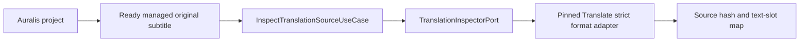

# Auralis Translate integration status

Status: inspection and storage integration in progress, 24 September 2026.

The independent Translate repository is pinned as a Git submodule at `modules/auralis-translate`. `.gitmodules` uses the relative sibling URL `../auralis-translate`. This local checkout builds against the pinned commit; the sibling GitHub repository must be created and pushed before another clone can initialise it from GitHub. Auralis excludes the nested workspace from its own workspace members and imports Translate crates through Cargo path dependencies. Translate rusqlite 0.39 and Auralis SQLx 0.9 resolve to one compatible `libsqlite3-sys` version.

## Implemented boundary

`adapters-translate::FormatInspector` calls the strict Translate SRT and WebVTT parsers through `TranslationInspectorPort`. It reads no more than each parser's declared maximum, returns the source SHA-256, exact segment text ranges, timing, order, and optional external cue label, and rejects unsupported syntax. It does not modify the input. The adapter and Translate SQLite compile in the same Auralis Cargo graph.

`InspectTranslationSourceUseCase` checks that the project exists, that the source artifact is a ready managed `OriginalSubtitle` owned by that project, and that its recorded size matches the inspected file. It resolves the path through the Auralis artifact store before calling the inspector. Tests cover valid SRT/WebVTT extraction at the adapter boundary, rejected WebVTT syntax, project ownership, pending artifacts, changed source size, and unchanged source bytes on successful inspection.

Inspection is an application API, not yet exposed through Tauri or the UI. It does not create a Translate run or project translation link. The existing Auralis SQLite link/publication/outbox storage remains separate from Translate SQLite. The next write path must commit Auralis run intent first, then idempotently create the Translate run. Recovery must repeat that second step after a crash between the two database writes. A project result is selected only after the translated copy is a ready managed artifact.

## Checks

From the Auralis repository root, run `task rs:test:translate`, `task rs:test:ports`, `task rs:test:storage`, `task rs:test:application`, and `task rs:clippy`. The Translate submodule has its own `task check` and `task build`. Compilation and mock-based tests do not establish bilingual translation quality or a supported release configuration.
