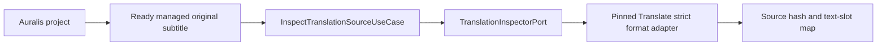

# Auralis Translate integration status

Status: inspection, durable run registration, experimental local-server execution, result publication, and storage integration in progress, 24 September 2026.

The independent Translate repository is pinned as a Git submodule at `modules/auralis-translate`. `.gitmodules` uses the relative sibling URL `../auralis-translate`. This local checkout builds against the pinned commit; the sibling GitHub repository must be created and pushed before another clone can initialise it from GitHub. Auralis excludes the nested workspace from its own workspace members and imports Translate crates through Cargo path dependencies. Translate rusqlite 0.39 and Auralis SQLx 0.9 resolve to one compatible `libsqlite3-sys` version.

The desktop bootstrap reserves one installation-wide `auralis-translate.sqlite` beside `auralis.sqlite`, constructs the strict Translate application use cases, and replays active frozen run intents after acquiring the application data-root lease. Individual registration failures are logged against their translation ID while desktop startup continues. After reconciliation, it enumerates only Auralis-linked active translation jobs, asks Translate SQLite to pause a running attempt only when its `host_job_id` matches, and atomically terminalizes each recovered host job. A mismatched or unavailable Translate run leaves the association active and is logged for attention. This startup pass does not resume inference. The read-only Tauri command `inspect_translation_source_cmd` accepts a project ID, managed original artifact ID, and `srt` or `vtt`; it returns the source digest, parser version, timing, cue identity, source text lines, and exact byte ranges. Project-scoped `get_translation_run_status_cmd` and `pause_translation_run_cmd` expose committed progress and durable pause requests. Start, execution, publication, and UI flows are not exposed yet.

The desktop frontend declares these commands in its typed IPC map and validates their responses at runtime, including bounded byte ranges inside the reported source size and the result identity of a validated run. No screen calls the commands yet.

The host translation job design in `modules/auralis-translate/docs/architecture/006-host-translation-jobs.md` defines the next S7 step: a translation job linked to a run and attempt, committed checkpoint progress, managed model runtime, and recovery scoped to Auralis-owned attempts. A distinct `Translation` job kind round-trips through the Auralis jobs table without changing the project's dubbing processing state. SQLite schema v8 adds `translation_host_jobs`: each job can reference one frozen run intent, historical jobs remain available, and a partial unique index permits at most one association with no `ended_at` per run. The migration preserves version-7 project links and run intents. `SqliteTranslationHostJobStore` atomically creates a pending job with its active run association, verifies the project and frozen intent, and atomically closes the association with a terminal job revision. `StartTranslationJobUseCase` checks project ownership, the frozen run and Translate phase, then creates or returns the pending job. The application recovery use case preserves committed Translate checkpoints, closes pending or completed host jobs after restart, and leaves mismatched attempts untouched. The existing dubbing recovery excludes translation jobs. Storage and application tests cover these boundaries, but desktop kill/restart verification and a worker are still pending. Model runtime ownership and committed host progress remain open.

The embedded HTTP adapter enables reqwest's rustls provider explicitly. A full workspace test exposed a feature-unification panic when reqwest had no provider; the aligned Auralis lockfile uses rustls 0.23.43 from the available offline dependency set. The full `task rs:test` passes with Translate pinned to the provider fix.

## Implemented boundary

`adapters-translate::FormatInspector` calls the strict Translate SRT and WebVTT parsers through `TranslationInspectorPort`. It reads no more than each parser's declared maximum, returns the source SHA-256, exact segment text ranges, timing, order, and optional external cue label, and rejects unsupported syntax. It does not modify the input. The adapter and Translate SQLite compile in the same Auralis Cargo graph.

`InspectTranslationSourceUseCase` checks that the project exists, that the source artifact is a ready managed `OriginalSubtitle` owned by that project, and that its recorded size matches the inspected file. It resolves the path through the Auralis artifact store before calling the inspector. Tests cover valid SRT/WebVTT extraction at the adapter boundary, rejected WebVTT syntax, project ownership, pending artifacts, changed source size, and unchanged source bytes on successful inspection.

Inspection is exposed through a read-only Tauri command and typed frontend IPC, but no UI screen calls it yet. Auralis SQLite schema v7 provides `begin_with_run_intent`, which atomically stores the project link and the exact frozen profile and planning configuration needed to retry Translate run creation. Schema v8 adds the host job/run association without changing this intent. `BeginTranslationUseCase` validates a ready project-owned original, inspects its strict format, freezes a validated model profile and parser policy, commits the link and run intent, then calls `TranslateRunRegistrar::ensure_run` against the separate SQLite file. Registration verifies the original hash and frozen configuration again before writing Translate translations, source segments, and the block plan. Repeating the same request is idempotent; a changed source or profile conflicts.

`ReconcileTranslationRunsUseCase` enumerates active links, reads their frozen intents, rechecks the original, and retries missing Translate records. It reports each link's outcome independently, including a legacy link with no frozen intent. A real two-database integration test starts with the Translate database directory absent, observes the persisted Auralis link, then creates the directory and reconciles the run. The original remains byte-for-byte unchanged. A project result is selected only after the translated copy is a ready managed artifact.

`ExecuteTranslationUseCase` rechecks the project-owned original and frozen run intent, ensures Translate records exist, then calls `TranslateRunExecutor`. The executor verifies the stored run and model profile, probes the supplied local llama.cpp server with the shared Translate preflight, executes missing blocks, and commits a structurally validated `needs_review` result in Translate SQLite. Repeating execution of a validated run returns its stored result ID. A checked model profile is required by the normal constructor; `experimental_unchecked` is restricted to development tests. A mock HTTP server test exercises execution and publication through the two databases while preserving the original bytes. This path is an application API with a caller-supplied server URL. Host job scheduling, runtime process ownership, progress events, mid-request cancellation, Tauri/UI exposure, and desktop-startup recovery wiring remain open. The mock HTTP test establishes protocol and persistence behavior, not real-model translation quality.

`TranslationRunUseCase` reads the active run's phase, committed block count, pending pause flag, and validated result identity through `TranslateRunControl`. It accepts a pause request only for a project-owned link whose Translate records match the linked source. An in-flight worker observes the durable flag at a block boundary; the current HTTP request is not interrupted. Calling execution again after an acknowledged pause resumes the same run and skips saved checkpoints. Tests cover pre-run pause/resume, a pause flag on a running attempt, project mismatch rejection, and the final result status. This control API has not been connected to host jobs or the UI.

`PublishTranslationResultUseCase` accepts a specific stored `result_id`. The Translate adapter confirms its run and source identities, renders a separate SRT/WebVTT copy from the original and selected segments, and checks the stored output digest. Auralis stages that copy, hashes the staged bytes, and atomically records the pending artifact, publication, and outbox action. Repeating the call returns the same pending or ready publication. The outbox worker selects the result only after finalizing the artifact. A real two-database test uses a deterministic mock HTTP model response to verify the full execution and publication lifecycle and an unchanged original; it does not establish language quality or a working host model job.

## Checks

From the Auralis repository root, run `task rs:test:translate`, `task rs:test:ports`, `task rs:test:storage`, `task rs:test:application`, and `task rs:clippy`. The Translate submodule has its own `task check` and `task build`. Compilation and mock-based tests do not establish bilingual translation quality or a supported release configuration.
