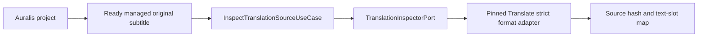

# Auralis Translate integration status

Status: inspection, durable run registration, result publication, and storage integration in progress, 24 September 2026.

The independent Translate repository is pinned as a Git submodule at `modules/auralis-translate`. `.gitmodules` uses the relative sibling URL `../auralis-translate`. This local checkout builds against the pinned commit; the sibling GitHub repository must be created and pushed before another clone can initialise it from GitHub. Auralis excludes the nested workspace from its own workspace members and imports Translate crates through Cargo path dependencies. Translate rusqlite 0.39 and Auralis SQLx 0.9 resolve to one compatible `libsqlite3-sys` version.

## Implemented boundary

`adapters-translate::FormatInspector` calls the strict Translate SRT and WebVTT parsers through `TranslationInspectorPort`. It reads no more than each parser's declared maximum, returns the source SHA-256, exact segment text ranges, timing, order, and optional external cue label, and rejects unsupported syntax. It does not modify the input. The adapter and Translate SQLite compile in the same Auralis Cargo graph.

`InspectTranslationSourceUseCase` checks that the project exists, that the source artifact is a ready managed `OriginalSubtitle` owned by that project, and that its recorded size matches the inspected file. It resolves the path through the Auralis artifact store before calling the inspector. Tests cover valid SRT/WebVTT extraction at the adapter boundary, rejected WebVTT syntax, project ownership, pending artifacts, changed source size, and unchanged source bytes on successful inspection.

Inspection is an application API, not yet exposed through Tauri or the UI. Auralis SQLite schema v7 provides `begin_with_run_intent`, which atomically stores the project link and the exact frozen profile and planning configuration needed to retry Translate run creation. `BeginTranslationUseCase` validates a ready project-owned original, inspects its strict format, freezes a validated model profile and parser policy, commits the link and run intent, then calls `TranslateRunRegistrar::ensure_run` against the separate SQLite file. Registration verifies the original hash and frozen configuration again before writing Translate translations, source segments, and the block plan. Repeating the same request is idempotent; a changed source or profile conflicts.

`ReconcileTranslationRunsUseCase` enumerates active links, reads their frozen intents, rechecks the original, and retries missing Translate records. It reports each link's outcome independently, including a legacy link with no frozen intent. A real two-database integration test starts with the Translate database directory absent, observes the persisted Auralis link, then creates the directory and reconciles the run. The original remains byte-for-byte unchanged. Host job scheduling, inference, Tauri/UI exposure, and desktop-startup recovery wiring are still open. A project result is selected only after the translated copy is a ready managed artifact.

`PublishTranslationResultUseCase` accepts a specific stored `result_id`. The Translate adapter confirms its run and source identities, renders a separate SRT/WebVTT copy from the original and selected segments, and checks the stored output digest. Auralis stages that copy, hashes the staged bytes, and atomically records the pending artifact, publication, and outbox action. Repeating the call returns the same pending or ready publication. The outbox worker selects the result only after finalizing the artifact. A real two-database test uses a deterministic fake provider to verify the full publication lifecycle and an unchanged original; it does not establish language quality or a working host model job.

## Checks

From the Auralis repository root, run `task rs:test:translate`, `task rs:test:ports`, `task rs:test:storage`, `task rs:test:application`, and `task rs:clippy`. The Translate submodule has its own `task check` and `task build`. Compilation and mock-based tests do not establish bilingual translation quality or a supported release configuration.
