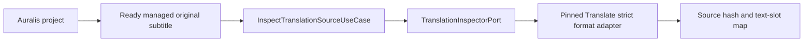

# Auralis Translate integration status

Status: inspection, durable run registration, experimental local-server execution, result publication, and storage integration in progress, 25 September 2026.

The independent Translate repository is pinned as a Git submodule at `modules/auralis-translate`. `.gitmodules` uses the relative sibling URL `../auralis-translate`. This local checkout builds against the pinned commit; the sibling GitHub repository must be created and pushed before another clone can initialise it from GitHub. Auralis excludes the nested workspace from its own workspace members and imports Translate crates through Cargo path dependencies. Translate rusqlite 0.39 and Auralis SQLx 0.9 resolve to one compatible `libsqlite3-sys` version.

The desktop bootstrap reserves one installation-wide `auralis-translate.sqlite` beside `auralis.sqlite`, constructs the strict Translate application use cases, and replays active frozen run intents after acquiring the application data-root lease. Individual registration failures are logged against their translation ID while desktop startup continues. After reconciliation, it enumerates only Auralis-linked active translation jobs, asks Translate SQLite to pause a running attempt only when its `host_job_id` matches, and atomically terminalizes each recovered host job. A mismatched or unavailable Translate run leaves the association active and is logged for attention. This startup pass does not resume inference. The read-only Tauri command `inspect_translation_source_cmd` accepts a project ID, managed original artifact ID, and `srt` or `vtt`; it returns the source digest, parser version, timing, cue identity, source text lines, and exact byte ranges. `list_project_translations_cmd` returns only an existing project's links, including unfinished `run_id` and ready selected `result_id`/artifact identities. Project-scoped `get_translation_run_status_cmd` and `pause_translation_run_cmd` expose committed progress and durable pause requests. `begin_translation_run_cmd` accepts stable caller-generated IDs for retry, currently permits Chinese input, and freezes the versioned checked experimental Hy-MT2 profile; a repeated call retains the original frozen timestamp. `edit_translation_result_cmd` stores a new result ID, and `publish_translation_result_cmd` returns a pending or ready publication while the outbox finalizes a separate copy. With a configured local runtime, `start_translation_run_cmd` starts a checked managed model process, drives a linked host attempt, and stages a validated publication. The subtitle workspace exposes start, resume, committed progress and durable pause controls.

The desktop frontend declares these commands in its typed IPC map and validates their responses at runtime, including bounded byte ranges inside the reported source size, paired selected result/artifact identities, publication state, and the result identity of a validated run. `get_translation_comparison_cmd` reads a requested result as pages of 1–100 paired source and translated segments. It checks the project-owned original, frozen parser version, Translate source/run/result identities, and reconstructed output digest. A ready older publication remains readable after a newer run starts; a page past the end is empty. The page limit bounds the IPC response; the backend still verifies the full result before slicing it. The project subtitle workspace lists project-linked translations and compares the currently selected ready result in pages of 25 segments. It shows the source and translated lines and the `needs_review` label and can stage a one-segment edited revision. The run panel refreshes the comparison when polling observes a changed ready selection. Historical revision selection remains open.

The host translation job design in `modules/auralis-translate/docs/architecture/006-host-translation-jobs.md` defines the remaining S7 work: a translation job linked to a run and attempt, managed model runtime, and recovery scoped to Auralis-owned attempts. A distinct `Translation` job kind round-trips through the Auralis jobs table without changing the project's dubbing processing state. SQLite schema v8 adds `translation_host_jobs`: each job can reference one frozen run intent, historical jobs remain available, and a partial unique index permits at most one association with no `ended_at` per run. The migration preserves version-7 project links and run intents. `SqliteTranslationHostJobStore` atomically creates a pending job with its active run association, verifies the project and frozen intent, records checkpoint progress with revision checks, and atomically closes the association with a terminal job revision. `StartTranslationJobUseCase` checks project ownership, the frozen run and Translate phase, then creates or returns the pending job. The application recovery use case preserves committed Translate checkpoints, repairs a lagging host counter before closing a running job, closes pending jobs after restart, and leaves mismatched attempts untouched. The existing dubbing recovery excludes translation jobs. The caller-driven `RunTranslationHostJobUseCase` moves a pending job to running, passes its ID into Translate's durable attempt, mirrors only committed block counts into the running job, and atomically closes the host association as completed, failed, or cancelled. The count includes previously saved checkpoints on resume; the host percentage remains below 100 until completion. Mirror failures are logged while Translate SQLite retains the authoritative checkpoints. A mock HTTP test covers host-owned execution, saved progress, and separate artifact publication across the two databases; an unreachable-server test leaves zero saved blocks, a resumable failed run, and an unchanged original. A two-database reopen test now checks scoped recovery, retained checkpoint and project link, repaired host count, and a new pending job on the same run. It simulates a stopped worker by closing both database handles; an actual desktop process kill remains to be tested. Desktop kill/restart verification, installation, native desktop real-model invocation, scheduler attachment, and UI progress events remain open.

The embedded HTTP adapter enables reqwest's rustls provider explicitly. A full workspace test exposed a feature-unification panic when reqwest had no provider; the aligned Auralis lockfile uses rustls 0.23.43 from the available offline dependency set. The full `task rs:test` passes with Translate pinned to the provider fix.

## Managed runtime setup for the current development build

Place `translation-runtime.json` beside `auralis.sqlite` in the Auralis application data directory. The file is optional so the rest of Auralis starts without installed model assets. Both paths must be absolute and point to an installed `llama-server` executable and the GGUF named by the frozen checked profile. Example for a local Windows development installation:

```json
{
  "executable": "C:/path/to/llama-server.exe",
  "model_file": "C:/path/to/Hy-MT2-1.8B-Q4_K_M.gguf",
  "context_tokens": 2048,
  "gpu_layers": 99,
  "startup_timeout_seconds": 120,
  "readiness_interval_milliseconds": 250
}
```

`gpu_layers: 0` selects a CPU-only attempt. The runtime validates configuration values at startup and checks installed files when a run starts. The start command checks project/run ownership and Translate phase, reserves the single model slot, verifies the frozen profile and installed model digest, launches its own loopback child, checks the server's reported model/runtime identity, then creates the host job. An admission error leaves no new job. Windows process ownership uses a kill-on-drop Job Object; Unix currently kills the direct child on drop. The lease ends before output staging. Translate SQLite retains checkpoints and the Auralis project link through failure or pause; the outbox selects a result only after its separate output artifact becomes ready.

The UI polls committed progress every three seconds and distinguishes `pause_requested` from `paused`. A pause waits for the current model request to return. The configuration file is a development installation contract, not an asset installer or release package. An opt-in managed-process test has passed through both real SQLite files and output finalization using the checked local model. Native desktop invocation, desktop kill/restart, bilingual review, packaged runtime installation, and progress events remain open.

## Implemented boundary

`ImportTranslationSourceUseCase` now imports a local SRT or WebVTT file into an existing project without altering the external file. It requires an extension matching the requested strict format, parses the source before staging, verifies that the staged managed copy has the inspected size and SHA-256, and atomically records a pending `OriginalSubtitle` artifact with an outbox finalization action. The desktop subtitle workspace offers a file picker, lists pending and ready originals, and lets the user prepare a Chinese → Russian frozen run from a ready original with stable retry IDs. Import does not start inference. A two-database integration test finalizes an imported copy, inspects it, registers a Translate run, rejects unsupported input, and confirms the external original is unchanged.

`adapters-translate::FormatInspector` calls the strict Translate SRT and WebVTT parsers through `TranslationInspectorPort`. It reads no more than each parser's declared maximum, returns the source SHA-256, exact segment text ranges, timing, order, and optional external cue label, and rejects unsupported syntax. It does not modify the input. The adapter and Translate SQLite compile in the same Auralis Cargo graph.

`InspectTranslationSourceUseCase` checks that the project exists, that the source artifact is a ready managed `OriginalSubtitle` owned by that project, and that its recorded size matches the inspected file. It resolves the path through the Auralis artifact store before calling the inspector. Tests cover valid SRT/WebVTT extraction at the adapter boundary, rejected WebVTT syntax, project ownership, pending artifacts, changed source size, and unchanged source bytes on successful inspection.



Inspection is exposed through a read-only Tauri command and typed frontend IPC, but no UI screen calls it yet. Auralis SQLite schema v7 provides `begin_with_run_intent`, which atomically stores the project link and the exact frozen profile and planning configuration needed to retry Translate run creation. Schema v8 adds the host job/run association without changing this intent. `BeginTranslationUseCase` validates a ready project-owned original, inspects its strict format, freezes a validated model profile and parser policy, commits the link and run intent, then calls `TranslateRunRegistrar::ensure_run` against the separate SQLite file. Registration verifies the original hash and frozen configuration again before writing Translate translations, source segments, and the block plan. Repeating the same request is idempotent; a changed source or profile conflicts.

`ReconcileTranslationRunsUseCase` enumerates active links, reads their frozen intents, rechecks the original, and retries missing Translate records. It reports each link's outcome independently, including a legacy link with no frozen intent. A real two-database integration test starts with the Translate database directory absent, observes the persisted Auralis link, then creates the directory and reconciles the run. The original remains byte-for-byte unchanged. A project result is selected only after the translated copy is a ready managed artifact.

`ExecuteTranslationUseCase` rechecks the project-owned original and frozen run intent, ensures Translate records exist, then calls `TranslateRunExecutor`. The executor verifies the stored run and model profile, probes the supplied local llama.cpp server with the shared Translate preflight, executes missing blocks, and commits a structurally validated `needs_review` result in Translate SQLite. Repeating execution of a validated run returns its stored result ID. A checked model profile is required by the normal constructor; `experimental_unchecked` is restricted to development tests. A mock HTTP server test exercises execution and publication through the two databases while preserving the original bytes. This path is an application API with a caller-supplied server URL. The managed start command now owns a checked runtime lease and is exposed in the desktop UI; native desktop real-model invocation, model installation, progress events, and mid-request cancellation remain open. The mock HTTP test establishes protocol and persistence behavior, not real-model translation quality.

`TranslationRunUseCase` reads the active run's phase, committed block count, pending pause flag, and validated result identity through `TranslateRunControl`. It accepts a pause request only for a project-owned link whose Translate records match the linked source. An in-flight worker observes the durable flag at a block boundary; the current HTTP request is not interrupted. Calling execution again after an acknowledged pause resumes the same run and skips saved checkpoints. Tests cover pre-run pause/resume, a pause flag on a running attempt, project mismatch rejection, and the final result status. This control API has not been connected to host jobs or the UI.

`PublishTranslationResultUseCase` accepts a specific stored `result_id`. The Translate adapter confirms its run and source identities, renders a separate SRT/WebVTT copy from the original and selected segments, and checks the stored output digest. Auralis stages that copy, hashes the staged bytes, and atomically records the pending artifact, publication, and outbox action. Repeating the call returns the same pending or ready publication. The outbox worker selects the result only after finalizing the artifact. A real two-database test uses a deterministic mock HTTP model response to verify the full execution and publication lifecycle and an unchanged original; it does not establish language quality or a working host model job.

`EditTranslationResultUseCase` checks project ownership, the original source, and the run recorded by either the active link or its ready selected publication. The Translate editor verifies the frozen run and base result, then commits a manual segment edit as a new immutable `needs_review` result. It rejects a stale base revision, invalid text, and changed source or run identity. The publication use case can stage a revision from the same selected run after the active run has closed. Its pending artifact and outbox retain the earlier ready selection until the new copy is ready; the storage comparison checks the link revision, selected run, source hash, and ready artifact before switching result IDs. A mock HTTP two-database test covers edits both before and after first publication, idempotent edit replay, stale-base rejection, unchanged original and earlier output bytes, and rejection of a staged selection after a newer run starts. Tauri and typed frontend IPC expose edit, publication, and paginated comparison. The subtitle workspace can edit one selected result segment and stage the new copy; a failed publication retries with the same edit ID. It shows pending publication until the user refreshes the project links. Older revision selection, real inference evidence, and automatic publication refresh remain open.

## Checks

From the Auralis repository root, run `task rs:test:translate`, `task rs:test:ports`, `task rs:test:storage`, `task rs:test:application`, and `task rs:clippy`. The Translate submodule has its own `task check` and `task build`. Compilation and mock-based tests do not establish bilingual translation quality or a supported release configuration.
